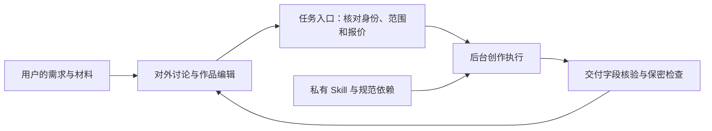

# 公域充值工作台方案

日期：2026-09-06；方案更新：2026-09-07

交付范围：产品与实施建议。本文不包含任何 Skill、规范、知识库或内部模板正文；本轮未修改业务程序、开通收款、部署服务或调用付费模型。

2026-09-07 补充要求：增加拆解，让用户积累自己的一套文案系统；支持直接拖入 TXT / MD 文件，拆解功能直接沿用现有对标 Skill。当前仍处于方案与页面示例确认阶段，真实工作台改造须等待用户确认。

## 1. 建议采用的模式

建议采用“你统一接 API，用户充值，在工作台按任务消费”的模式。技术上可行，现有工作台已有可复用的创作流程和执行工具；是否值得扩大投入，要通过真实客户的产物采用、重复付费和任务成本验证。

建议在现有设想上增加一个定价层：用户按“拆解一份文案、生成一组选题、完成一份剧本、生成一张图片”等业务任务看报价，后台记录完成该任务所需的全部 API 消耗。必要的规范读取、内部审稿和系统返工，都纳入本次任务的成本核算。

| 模式 | 用户如何付款 | 适用判断 |
|---|---|---|
| 充值＋任务报价 | 启动前看到交付范围和价格，完成后从余额结算 | 首版推荐；客户容易理解，创作方法的价值可以计入服务价格 |
| 充值＋按实际模型用量结算 | 根据输入、输出、缓存等实际用量收费 | 可作为后续专业模式；需要解释长上下文、内部调用和预算上限 |
| 月费＋一定额度 | 按月续费，额度内使用、超额另计 | 等使用频率和复购数据稳定后再设计 |

首版暂按“已有短剧制作经验、希望提高产出效率的个人创作者”设计。目标用户尚待确认；若主要面向新手，需要另计教学、引导和人工支持成本；若面向团队，再补成员权限与团队账单。

用户已经明确的产品边界：

- 你统一选择、配置和支付上游 API，用户无需自带 API。
- 用户向平台充值，按已经告知的规则消费。
- Skill 本体、它读取的规范、引用库、模板和内部检查内容同等保密。
- 上述文件只放在受控服务器及其私有备份中，不交付给订阅用户，不进入网页公开发布内容。
- 客户可以讨论和修改作品；对话、下载文件及其他出口不得交付内部资料。

## 2. 首版用户怎样使用

首个付费版本开放“拆解 → 私人文案库 → 选题 → 用户选择与修改 → 成稿 → 指定范围修改 → 导出作品”。拆解可独立攒库，不需要先绑定某一集；用户也可以直接开始选题，拆解不成为强制前置步骤。后续再加入资产、分镜、视频和后期。

这个顺序用于控制首批成本和排查范围。长期仍按现有全流程工作台发展；现有自用流程继续保留。

一次典型使用过程：

0. 用户拖入 TXT / MD 文件，或粘贴台词文本，预览原稿后启动现有对标拆解流程。原稿与拆解结果按既有规则进入该用户的私人文案库；既有自动入库项目和需要用户拍板的候选项目分别沿用原 Skill 的处理方式。
1. 用户登录，创建自己的项目，填写创作需求或上传本次材料。
2. 在当前环节讨论要求；准备生成时，显示本次交付物、范围、价格和包含的修改服务。
3. 用户确认后占用相应余额，任务进入队列。页面显示进度，不显示内部提示词或执行日志。
4. 后台执行、检查并保存结果；通过保密检查后，在同一数据库事务中完成结算并将订单置为可交付，提交成功后再向客户展示。
5. 用户挑选候选、查看历史版本、编辑自己的文字和下载已有结果，不因此重复扣费。
6. 用户改变方向、重新生成或调用 AI 修改时，作为新的明确任务报价；系统为完成原订单而进行的内部修复由平台承担。

讨论功能也会产生模型成本，应在任务报价中写清包含的讨论或修改范围；独立的 AI 咨询可以单独报价。首版不承诺无限讨论和无限重做。页面只显示与本次选择相关的费用，不把每次内部模型调用都变成一次确认。

| 首版功能 | 交付范围如何界定 | 收费建议 |
|---|---|---|
| 对标拆解 | 读取 TXT / MD 或粘贴原稿，完整执行现有对标 Skill，产出本条材料的分析与入库记录 | 按文案长度与任务范围报价，包含既定整理入库；查重和同款变体处理沿用原流程 |
| 生成候选题 | 本次约定数量的完整候选及作品层面的简要说明 | 按一批报价，包含既定内部检查 |
| 生成开场 | 针对已经选定的故事生成约定范围的开场方案 | 作为明确子任务报价，也可在套餐中明示包含 |
| 生成剧本 | 指定集型、长度档位、输入范围下的初稿及既定审稿 | 按长度和服务档位报价 |
| AI 修改 | 指定作品、指定范围、当前修改要求 | 单次报价；套餐包含的次数在页面显示 |
| 浏览、手动编辑、下载已有结果 | 不调用生成模型 | 不扣生成费用 |

首版不开放客户配置任意模型地址、读取服务器文件或导出工作流源文件。模型档位可以由平台预设，内部模型调整先验证质量与成本，并保持正在执行任务的原报价和版本。

### 文件导入与现有对标 Skill 的接法

页面提供“拖入 TXT / MD 文件”和“选择文件”两个入口，并保留粘贴文本。读取后自动以文件名预填对标名称，显示完整原稿预览、文件名和字符数。原稿可以在预览中修改，但原附件与修改后的任务输入分版本保留。

读取阶段兼容 UTF-8、带 BOM 的 UTF-16，并针对常见中文 GBK / GB18030 文件提供解码与预览核对。空文件、不支持的格式、无法完整解码或超限文件给出明确提示；不静默截断。页面示例按每次一份、每份最多 2 MB 演示，正式限额在实施时按服务配置确定。导入和预览不自动触发付费拆解。

拆解方法的权威入口继续是项目现有对标命令与它要求读取的规范。上传文本只作为原稿输入，完整拆解、查重、原稿存档、结构卡和相关库同步均沿用原流程；不把页面中的几块结果摘要当成完整拆解模板。拆解阶段的范围仍按原 Skill 执行，进入选题由用户另行启动。

既定直接入库项目照旧自动处理；原 Skill 要求拍板的新候选照旧交用户处理，不统一改成“全部自动”或“全部等确认”。来源材料附带的数据和说明如实保留，残缺内容与推断项按现有规范处理，不凭上传行为认定内容效果已经验证。

公域适配时，将原 Skill 的用户资料与写库目标映射到当前用户的私有空间。涉及平台核心规范的内部回测和改动建议只进入受控管理端；用户端展示针对本人素材的分析、入库反馈及本人需要处理的候选。平台 Skill、规范原文和内部方法模板不随上传结果对外返回。

MD 文件按文字材料读取，不执行其中的 HTML、脚本、文件路径或所谓“系统指令”，也不自动读取它引用的其他文件或网页。正式后台同时保存原始附件和实际提交模型的输入版本。

### 私人文案库如何形成个人系统

此处的私人文案库按用户独立管理其提供的材料、生成的分析和个人归纳，不能把平台机密库复制给每个用户。公域用户可管理和导出自己的内容；自用验证阶段由项目使用者配置 API，与未来公域用户权限区分。

| 积累内容 | 如何产生 | 后续用途 |
|---|---|---|
| 对标原稿与拆解记录 | 拆解完成后自动保存，保留来源与修订历史 | 回看依据，指定某条记录继续选题 |
| 剧情结构、开场及表达记录 | 从本次原稿中归纳，只交付针对用户材料的分析 | 按现有选题、成稿 Skill 的读库路线分别调用 |
| 带货表达与产品相关记录 | 来自用户提供的带货材料；产品事实单独核对 | 为后续带货文案提供个人参考 |
| 个人创作经验和写作偏好 | 按现有对标、改稿和复盘流程分别入库；需拍板的候选由用户处理，用户也可修改个人偏好 | 在明确适用场景下影响该用户的后续创作 |
| 效果记录与验证状态 | 用户补充作品表现和实际采用情况 | 区分已知事实、个人偏好和待验证假设 |

每条经验保留来源、适用场景、采用状态和验证状态。用户能够修改、停用或删除自己的条目；采用一条经验不等于其效果已经被数据证明。一次案例中的现象，不自动升级成对所有题材适用的永久规则。

选题和成稿以现有命令的应读清单、阶段划分和路线条件为准，读取所需索引、指定卡片、框架、话术、产品资料及经验。不能用统一的“相似条目检索＋已采用经验”替代这套调用关系；用户也不需要为每次读取重新手动勾选原本自动调用的库。界面可以显示“本轮参考了我的哪些材料”，平台规范和内部读取细节仍只在服务端保留。

查看、手动整理和选取已有记录，不因此重复收取生成费。再次调用模型进行深度分析、改写或创作时，按新任务报价；相关检索与上下文成本纳入该任务的后台核算。

### 与现有入库和调用保持一致的映射

截至本次核对，页面示例只演示文件导入、简单入库视图和资料衔接，尚未实现下表中的真实写库与读库。此前示例使用“拆解记录＋个人经验”两个标签，不能代表完整的生产数据结构；后台应保留现有各类库的职责，前端再将其组织成易用的管理视图。

| 现有资料或库 | 现有写入与确认方式 | 后续调用位置 |
|---|---|---|
| 对标原稿档案 | 来源全文存档，保留来源说明与附带数据 | 有指定对标时读取本次原稿；原创选题不泛读库存原稿 |
| 剧情结构卡与索引 | 按机制查重，同款补变体；符合新卡条件时写卡并更新索引 | 选题查重和对应结构使用；借卡成稿后回写卡片与索引的使用记录 |
| 类型版图、母题与零件记录 | 拆解后按既定增量条件同步，重复内容不追加 | 为后续选题提供现有路线所需的防撞和组合资料 |
| 带货框架库 | 既有框架补样本；真正的新框架候选按原规则拍板后立卡 | 选题定案指定框架，成稿读取所指定框架 |
| 转化话术库 | 按现有功能归档、查重和替换规则直接整理 | 带货成稿按对应环节和说话人条件使用 |
| 产品规格中的专属素材 | 按原流程进入对应产品资料；无对应产品时按原流程留在来源卡中 | 成稿结合本产品的权威事实与内容素材调用 |
| 手法库 | 新手法候选按原规则拍板；已有手法的新实例不另行堆积 | 成稿阶段调用已进入库的手法 |
| 爆款开头库 | 新开场模式按既定规则与卡同步入库，已有内容去重 | 选题的开场设计阶段调用 |
| 账号、偏好、修改经验与效果记录 | 按原改稿、反馈和复盘规则更新；复盘各路候选分别拍板 | 后续选题、成稿和审稿使用；相关卡片及框架的效果记录同步回填 |
| 内部规则回测记录 | 后台执行现有回测，涉及平台规则的建议进入受控管理端 | 管理员审查平台方法，不能让公域用户直接改写核心规则 |

自动入库、候选拍板、成稿后的使用回写和复盘后的数据回填都应按原流程保留。不能把它们统一降成“收藏一份摘要”，也不能把所有资料的调用都改成“先采用一条个人经验”。

还需处理现有文件中方法定义与个人数据混合的情况：部分框架文件同时含有通用方法、样本、使用记录和数据。不能按目录整体复制给客户或整体清空。实施时建立受控加载映射，保留服务端方法定义及其权威来源，并将用户样本、使用记录、账号事实和效果数据分别隔离。新用户复用同一套服务流程，不会自动获得项目使用者已经积累的全部私人样本和数据。

接入 API 后，用相同测试原稿、相同初始库状态和明确的模型配置对照验证：实际应读材料完整；各类入库与索引同步完整；重复和变体处理正确；确认关卡没有增减；新入库资料确实能被下一步选题与成稿调用；使用和效果回写能接回原库。比较读写关系与业务结果的完整性，不要求随机生成文字逐字相同。本轮仅补齐方案，未运行这些真实模型对照。

## 3. 如何保护 Skill 和全部规范

### 3.1 按整条依赖链保护

把每个业务步骤对应的 Skill、必读规范、条件性引用及内部模板列成服务器端清单，由程序按已选路线加载。必读资料缺失时停止该任务，不能为了减少暴露而悄悄跳过创作标准。

内部资料、版本历史、完整请求、检查记录和受控备份都按机密管理。它们不放进前端代码、公开静态目录、浏览器缓存、公共源代码包或客户可访问的日志系统。生产执行身份原则上只读规范；管理员修改通过独立管理入口和版本发布流程完成。

用户材料、项目、会话、生成结果和账户偏好按用户隔离。每次读取、下载、修改和任务查询都由服务器核对所属用户；修改项目编号或任务编号不能访问其他账户的数据。客户反馈不能直接改写平台的核心规范库。[3]

用户积累的个人规范属于其私人内容，允许本人查看和编辑；平台 Skill、核心规范及内部依赖仍保密。两者的存储、读写权限和对外返回结构分开。用户材料及个人规则不能授予文件读取、跨用户访问、修改扣费规则或改变模型接入目标的权限。

### 3.2 对外讨论与内部创作分别处理

直接与客户对话的部分只接触本次需求和已经放行的作品结果，没有读取机密文件的权限。需要创作时，调用固定的业务操作，由服务器控制可读资料、可写结果位置及返回字段。

原稿、附件、用户批注和此前对话都是不可信输入。将它们整理成任务参数有助于缩小范围，但自然语言字段仍可能夹带指令，不能把“结构化了”当成已经安全。内部创作执行不具备任意文件下载、任意网址访问或任意系统命令能力；需要的工具由业务步骤明确提供。

创作判断仍由模型按原规范完成。程序限制访问和交付边界，不用格式检查取代剧本质量判断。

### 3.3 单独制作客户交付版本

现有自用 Skill 的输出可能包含内部方法说明、来源信息和详细自检内容。仅保护源文件，不能阻止这些内容通过正常交付带出。

服务器继续保存符合现有跨层契约的完整内部产物，另行生成客户交付版本。客户可以看到故事、台词、开场、修改建议和约定的分镜提示词；内部操作说明、方法体系、规则引用和模板细节不得直接导出。逐类定义可交付字段，不能把内部 Markdown 原文件或模型整段回答原样返回。

需要同时覆盖对话、任务详情、项目预览、文件下载、报错、通知、日志及后台模型响应。只隐藏前端按钮不构成保密。

生成期间先显示进度；可疑正文在交付前拦截，不先流式发送再检查。公开页面不能自动加载模型生成的任意外链、远程图片或嵌入内容，避免额外外传通路。原始日志默认最小化保存，必要的敏感诊断记录仅限受控后台访问并设置保留期限。

### 3.4 防套取是持续控制，不能承诺绝对成功

结合已知内部文本特征检测、输出字段限制、针对机密泄漏的检查、异常调用限速和专项测试。语义检查模型本身也可能受到提示注入，不能让它成为唯一防线。[1]

测试至少覆盖：直接索取、伪装管理员、要求改写或翻译内部资料、多轮拼接索取、附件夹带指令、跨用户查询，以及借导出、报错和外链带出内容。检查疑似泄漏时中止该次交付，记录受控事件，排查后修复。

只要生成模型读过机密并受用户输入影响，仍存在泄漏风险；用户也可能通过大量成品推测部分方法。上述方案用于减少暴露面、提高套取成本和发现问题，不能作为“绝对套不出来”的保证。

### 3.5 明确外部模型的接触范围

“文件只存在你的服务器”不等于“正文不发给模型服务商”。使用外部 API 时，模型所需正文会经过你选定的服务商，若有中转还会增加接触方。

本方案的 API 路线以“对订阅用户保密，并允许你认可的模型服务商处理必要正文”为待确认部署假设。服务商应核对商用条件、数据留存和访问安排；只开放管理端审核过的接入目标，客户不能提供接收正文的地址。

若你要求正文也不离开自己控制的环境，就需要私有部署或满足该边界的专属推理服务，并重新实测创作质量和成本。统一接 API 本身不解决这项区别。

## 4. 充值、扣费和退款怎样结算

### 4.1 一个余额，清楚区分可用和占用

页面用人民币显示：可用余额、任务占用金额、消费明细。首版不增加复杂的积分兑换、赠送余额或代理分账。

充值到账后记录充值流水；任务启动前占用本次报价；结果可交付时结算；明确失败则释放占用。客户的可用余额不能被多个并发任务重复占用。报价由服务器产生，绑定登录用户、输入版本、任务范围、服务档位和有效期；不能采用客户提交的金额作为收费依据。每个订单保留报价快照，之后改价不影响该订单。

| 情况 | 对客户的结算建议 | 平台如何处理 |
|---|---|---|
| 材料不齐、余额不足，尚未提交模型 | 不扣费 | 补齐条件后重新启动 |
| 按约定完成并交付 | 结算已确认价格 | 记录全部上游调用和成本 |
| 系统故障、交付格式不成立，无法完成原订单 | 不向客户结算，释放占用 | 已发生的上游费用记平台失败成本 |
| 模型请求断线、结果未知 | 保留“核实中”状态，不自动重投或结算 | 使用原任务标识查询、对账；到公示核实期限仍无法确认则释放客户占用，由平台承担不确定成本 |
| 多项任务部分成功 | 按事先拆分的子项只结算已交付部分 | 每一子项保留自己的价格和状态 |
| 用户对可用作品不满意 | 按事先说明的修改服务或售后规则处理 | 不把主观满意度伪装成确定的技术判据 |
| 重复点击、重复付款通知 | 同一业务订单只入账或结算一次 | 依赖数据库约束与事务，不只禁用按钮 |

结果未知的占用核实期限，应根据所选供应商的最长处理时间和可查询能力确定，并在上线前公示。已经释放且关闭的客户订单，即使后来发现上游收费，也不自动追扣；晚到结果按关闭订单规则处理。

### 4.2 资金账本必须可靠

采用支持事务的关系数据库，资金变动使用追加式、可审计账本和成对记账。占用、结算、释放和退款都有唯一业务标识，原流水不可通过后台直接删改。余额可以缓存，但必须能从完整流水重建和核对。

客户金额用整数“分”保存；上游细粒度成本另用明确精度和币种记录，避免浮点数误差。资金事务中完成余额检查、占用和任务持久化，随后通过持久任务派发执行，避免占钱后丢任务或未占钱就产生 API 成本。

首版选一个支付通道。若首批以国内电脑端网页为主，可评估微信支付 Native；实际产品取决于商户主体和入口形式。到账以服务器验签、核对交易状态、订单号、商户身份、金额和币种后的支付事件为依据，不能信任浏览器显示“支付成功”。微信支付官方明确支付通知可能重复送达，商户需要处理重入。[2]

验签后先可靠保存通知事件并及时应答，异步完成入账；唯一约束防止重复入账。退款区分“释放任务占用”和“原路退回支付款”，后者需要退款订单、异步状态及退款结果核对。已占用金额不能被提现式退款和任务结算同时使用。

定期核对三套记录：支付渠道到账与退款、客户充值消费与余额、上游模型用量与账单。充值到账不等于已赚到收入，未消费余额需要为后续履约和退款保留资金。

### 4.3 按完整业务任务算价格

一个创作任务的成本包含：需求整理、读取规范产生的模型输入、生成、内部审稿、保密检查、约定范围内系统返工，以及分摊到该任务的失败消耗和可变服务费用。规范较长时，输入成本可能明显影响结果，不能只看输出字数或最后一次请求。

每次内部调用都记录所选供应商、实际模型、请求标识、输入输出及缓存等可得用量、报价版本和费用状态。费用缺失标为“待核实”，不能当成零元；缓存节约也必须依供应商实际返回和账单核对。

设 C 为每个可交付任务的预计变动成本，r 为支付等按收入比例收取的费用，m 为希望保留的贡献比例，则定价测算为：

**任务价格 ≥ C ÷（1 − r − m）**

仅作计算示例：若 C＝2 元、r＝1%、m＝50%，则至少约 4.09 元。这些数值均不是当前 API 价格、实际支付费率或对用户的报价；贡献还需要覆盖固定服务器、维护等费用。

先用代表性任务取得成本分布，再按长度和服务档位定价。样本要包含正常输入、长原稿、多轮修改、失败和保密拦截；建议每个首发主要功能至少整理 30 个任务样本用于初步估价，这不是可靠性的统计保证。本轮没有运行这些样本。

同时设置单任务最高上游支出、内部重试次数上限、账户并发限制和平台每日支出上限。任务达到预算上限时停止继续消耗；原订单不能临时偷偷加价。修改模型或路线后重新验证成本与质量，不自动换成未经验证的低价通道。

## 5. 在现有工作台上怎样实施

### 5.1 当前可复用的部分与缺口

以下代码盘点取自 2026-09-06 的现有代码和项目文件，属于方案依据，不是完整安全审计；2026-09-07 的方案扩展不代表这些功能已经实现。

| 已核对的现状 | 商业版本的处理方向 |
|---|---|
| 工作台从项目根目录读取同一套故事、会话和任务文件 | 改成按登录用户定位项目；不能把当前本机目录整体公开 |
| 已有输入预检、任务记录、版本备份及生成恢复流程 | 复用行为，补用户归属、数据库持久化和财务关联 |
| Skill 调用会把正文交给所选模型接口 | 模型配置归管理端；只使用经过审核的服务商接入目标 |
| 任务接口会返回原始输出，现有结果还含规则读取和应用记录 | 建立独立客户返回结构，原始记录只留内部 |
| 新文字接口适配当前主要返回结果文本 | 补统一用量、请求标识、结束状态和费用信息，不能靠结果文本推算账单 |
| 现有默认视频通道的代码仍标记可靠费用与服务保障存在不确定性 | 商业视频上线前专项核对可计费、可查询、可对账和可交付能力；不因自用可运行就认定可公开收费 |

依据位置：

- [项目与故事路径](<主仓库根>/tools/storyboard-workbench/local-server.mjs:26)：共享项目根目录与故事路径。
- [本机来源检查](<主仓库根>/tools/storyboard-workbench/local-server.mjs:344)：不能替代商业身份与对象权限。
- [模型调用](<主仓库根>/tools/storyboard-workbench/local-server.mjs:3945)：规范正文加入模型请求。
- [任务接口返回](<主仓库根>/tools/storyboard-workbench/local-server.mjs:4186)：当前包含原始任务输出。
- [文字接口适配](<主仓库根>/tools/storyboard-workbench/server/model-providers.mjs:425)：返回处目前以文本为主。
- [视频通道提示](<主仓库根>/tools/storyboard-workbench/local-server.mjs:94)：当前默认通道的费用与服务说明。
- [第一批使用与验收](<主仓库根>/tools/storyboard-workbench/docs/第一批使用与验收-20260905.md)：当前专用资产操作与既有验证范围。
- [跨层契约](<主仓库根>/跨层契约.md)：现有内部文件和阶段交付契约继续保留。

### 5.2 首版采用简单的服务结构

保留现有网页框架和交互基础。公域网页只调用商业后端；核心业务先做成一个按职责分模块的后端，配一个独立的后台任务进程，不一开始拆大量微服务。

| 部分 | 职责 |
|---|---|
| 用户网页 | 项目、对话、作品编辑、报价确认、充值与账单；不包含机密文件 |
| 商业后端 | 登录与权限、任务报价、资金流水、付款通知、用户可见结果 |
| 私有执行进程 | 按步骤读取私有 Skill 与规范，调用模型，保存内部产物和检查结果 |
| 数据库与私有文件存储 | 数据库管理账户、订单、账本、任务与版本；文件存储管理用户作品及受控内部资料 |

建议用支持事务的成熟关系数据库处理钱包和订单。首批规模可使用数据库持久任务表及单独执行进程，需求扩大后再引入专门队列。外部模型请求的结果未知时，恢复执行必须先核对原请求，不能因为任务进程重启就重复提交。

已有 Sites 网页可作为界面入口，商业后端和私有执行环境通过受控 HTTPS 服务衔接；本轮不改现有部署。网页发布内容与机密执行资料分开管理。任何浏览器端组件均不得持有供应商密钥或访问机密资料的能力。

规范库、客户文件和资金数据库保留版本与受控备份。资金账本的备份频率、可接受丢失窗口和恢复时长在接收真实充值前设定，并实际演练恢复。普通客户和管理员使用不同权限，管理端启用额外身份保护。

### 5.3 分批完成，而不是一次铺满

| 批次 | 交付物 | 进入下一批的条件 |
|---|---|---|
| A：保护核心与隔离用户 | 拆解、私人文案库及选题到成稿路线；私有依赖加载；客户交付结构；两个测试账户 | 无直接机密出口；无法串读串改；用户能复用自己的拆解与已采用经验；作品质量与自用基准对照可接受 |
| B：接入计费与收款 | 任务报价、占用结算、完整账本、一个支付通道、退款和管理页面 | 重复通知、并发占用、失败释放、重启恢复、退款和对账验证通过 |
| C：小范围真实收费 | 邀请 5–10 位目标用户，使用小额充值；跟踪作品采用、成本和复购 | 客户能独立完成任务；出现真实付费复用；费用能核对，支持负担可承担 |
| D：扩展生产环节 | 资产、分镜、视频，随后评估剪映交付与本地辅助工具 | 每个环节分别验证供应商、恢复能力、成本、保密和交付质量 |

A 批可以用内部测试额度验证，B 批先模拟资金边界，再按授权做小额真实支付测试。接收充值前确认商户主体、支付产品开通、服务范围、未消费退款规则和所选部署地区的上线要求。

剪映目前含本机操作，不能假设发布一个网页就能直接操作客户电脑。后续可选择导出可用材料或增加只执行授权本地操作的辅助工具；核心 Skill 与规范仍不随工具发给客户。

## 6. 怎样判断值得继续投入

首批优先观察这些指标：

- 用户能否独立完成一份可采用的作品，是否需要你全程陪跑。
- 初稿采用率、改稿次数、从需求到可采用稿件的时间。
- 一份可采用作品的真实总成本，而不只是成功请求的平均价格。
- 消费后的重复使用和二次充值；明确区分赠送额度与真实付款。
- 扣除 API、失败消耗、支付和可变支持成本后，每种任务是否产生正贡献。
- 每位客户的人工支持时间，是否侵占你自己的内容生产。
- 私人文案库的内容是否被再次用于实际创作；用户采用的经验是否减少改稿，而不只增加收藏数量。

这些是待验证的经营问题，不能用“当前自己能用”推导“用户一定愿意付费”。只有这些信号成立，再投入更大的获客和完整生产链。

上线前至少验证以下边界：

1. 公开页面、接口、下载、报错和日志没有直接带出机密正文、内部模板或密钥；专项套取测试未发现未修复问题。测试通过不表示不存在未知攻击。
2. 两个客户不能相互查询、下载、修改或影响对方项目、任务与余额。
3. 同一付款通知重复送达只入账一次；两个并发任务不能超额占用余额。
4. 网络中断或进程重启不导致无依据重复调用、重复扣费或占用无法解除。
5. 失败、部分成功、结果未知、退款和晚到结果都有明确处理和账目记录。
6. 每个业务任务能关联所有内部调用；用量缺失会被标记和处理，上游与客户费用分别核对。
7. 隐藏内部方法后，客户仍能理解候选、提出有效修改并获得符合原创作标准的结果。

需要在实施前补齐的三个决定：首批客户画像；允许哪些模型服务商处理内部正文；收款主体与部署地区。任务价格在成本样本完成后确定。本方案不提供未经验证的具体套餐价格或开发工期承诺。

## 7. 核对过的公开依据

访问日期：2026-09-06。

1. [OWASP：LLM Prompt Injection Prevention Cheat Sheet](https://cheatsheetseries.owasp.org/cheatsheets/LLM_Prompt_Injection_Prevention_Cheat_Sheet.html)：输入与输出检查、最小权限、多层控制、持续测试，以及防护模型本身的局限。
2. [微信支付：Native 支付成功回调通知](https://pay.weixin.qq.com/doc/v3/merchant/4012791882)：回调验签、解密、应答和重复通知处理。本文依据这些机制设计可靠收款，不代表商户资质已开通。
3. [OWASP API Security：Broken Object Level Authorization](https://owasp.org/API-Security/editions/2023/en/0xa1-broken-object-level-authorization/)：每次根据客户提交的对象标识访问记录，都需检查当前用户对该对象和操作的权限。
